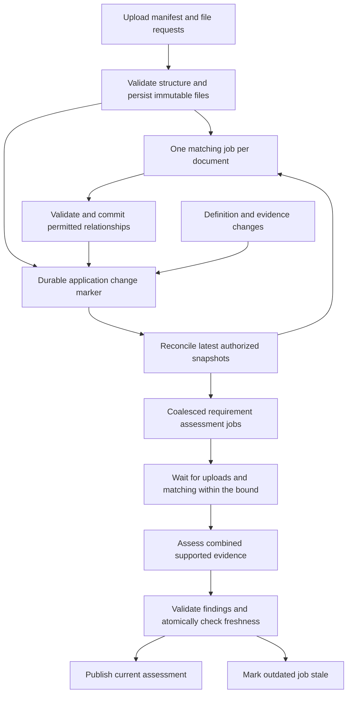

# AI document review workflow design

This is the maintained design for document matching and requirement assessment in Proximity. It explains application and model responsibilities, interfaces, concurrency, failure handling and architectural tradeoffs. The two product outcomes are to associate uploads with requirements and assess each requirement using its combined evidence.

Implementation baseline: `1c54354` plus the November 7, 2026 coverage/freshness fixes described below. This describes source behavior, not a deployed environment. Migration 013 and compatible server/worker configuration are required before rollout.

## Document ownership and maintenance

The AI integration chat maintains this document alongside implementation. The **AI workflow edge cases and recovery** chat maintains the detailed scenario inventory and reviews failure-handling changes. These are complementary responsibilities, not separate competing designs.

| Document | Responsibility |
| --- | --- |
| [Requirements](AI_WORKFLOW_REQUIREMENTS.md) | Intended functional behavior and nonfunctional requirements |
| [Feature support](AI_FEATURE_STATUS.md) | Product-facing inventory of supported features, limitations and next work |
| This design | Architecture, interfaces, decisions, current behavior and deliberate limitations |
| [Edge cases](AI_WORKFLOW_EDGE_CASES.md) | Stable E01–E43 scenario IDs, expected behavior, user recovery and implementation gaps; F01–F20 fault-injection plans |
| [Test plan](AI_WORKFLOW_TEST_PLAN.md) | Traceability to actual tests, verification evidence and remaining coverage gaps |

For every workflow behavior change, update the affected design section, scenario status and test traceability in the same change. Record why a decision changed, what evidence supports it, and any migration/configuration impact. A test passing, source implementation existing and a production rollout completing are separate claims. New scenarios receive new IDs; existing IDs are not renumbered to hide gaps. Review edge cases before broadening model authority, evidence formats, batch scope or retry behavior.

## Architecture and responsibility boundaries

The application orchestrates durable work. Models perform bounded interpretation with no tools, memory, direct database writes or autonomous planning loop. The queue owns retries; provider SDK retries are disabled.

An upload response confirms file persistence, not successful matching or fulfilled requirements. Matching relevance does not establish completeness. AI findings never accept or waive a requirement on the lender's behalf.

The web app uses PostgreSQL transactions for domain changes and scheduling. A separate Node worker claims jobs, prepares evidence, reserves provider capacity, calls OpenRouter through Mastra and commits validated results. No provider request runs inside a database transaction. The deployed storage model remains private local files plus PostgreSQL; there is no Redis dependency.

## Units of work and interfaces

| Operation | Application supplies | Model returns | Application owns |
| --- | --- | --- | --- |
| Prepare document | Immutable document ID, hash, content type and authorized private bytes | No model is needed for current CSV preparation | Structural bounds, integrity verification, exact records/cells and limitations |
| Match document | One prepared document and multiple current application requirement definitions | Classification and one relevance finding per candidate, reasons/citations, preliminary criterion checks | Complete candidate coverage, ID/citation validation, human-correction precedence, relationship writes |
| Assess requirement | One requirement and its entire associated supported evidence set, with processing limitations | Every criterion's finding and evidence, missing items, conflicts, limitations and legacy summary | Coverage validation, deterministic aggregate status, freshness and publication |

Current durable task names are `match_document.v1` and `verify_requirement.v1`; response schemas are `match.v1` and `verify.v1`. The prompt/analysis version is `csv-review.v5`. Current relevance values are `relevant`, `not_relevant`, `ambiguous`; criterion states are `met`, `unmet`, `unknown`, with conflicts separately represented. These are implementation contracts, not synonyms to change casually in an API response.

Jobs store a pinned input snapshot and fingerprint, including model/analysis version, document hashes and version lineage, requirement definitions, relevant mappings/rejections and evidence identity. Borrower fingerprints additionally bind personal consent epoch and initiating user; lender fingerprints bind the initiating user and submitted package. Input references do not grant authority: permissions are checked before private reads, dispatch and commit.

Citations currently identify document, logical CSV record, column and exact cell text. Headers are record 1. A real quote proves source identity, not the truth of the model's interpretation. Page/OCR citations are a future contract, not implemented coverage.

The current match response includes preliminary criterion checks. Only the aggregate requirement assessment determines the displayed fulfillment outcome. A future relevance-only response could reduce matching output cost; it requires a versioned contract and evaluation rather than silently dropping fields.

## Single and multiple upload workflow

The current upload UI creates a durable manifest for one or more files before sending bytes. Each member has an ID, filename, hash and optional manually selected requirement. The API caps a manifest at 50 members and a user at 10 open batches. Retries reuse the manifest identity; changing its contents under the same ID is rejected. Upload POST still accepts requests without batch references, so not every API upload is guaranteed a durable batch of one.

Files upload independently. Each saved file and its batch membership are committed with its relationships and matching enqueue. Successful members survive failures elsewhere. An exact-byte duplicate can satisfy a member if the required relationship already exists; the upload does not silently invent a new manual relationship. Same-user reselected bytes may resolve earlier incomplete members when their relationship requirements are satisfied.

Finalization marks unsaved members failed. The worker expires open batches after five minutes; saved files continue processing. A late saved member or reselected exact file can resolve the missing evidence and trigger a fresh assessment. Server manifests survive a browser close, but unsent browser bytes do not. There is not yet a full cross-session batch recovery UI.

**Current barrier scope is application-wide.** A borrower assessment waits while that application has an open unexpired batch or an active matching job created within the last five minutes. Lender submitted-package checks bypass this draft barrier. This is simpler than a per-batch dependency graph and conservatively avoids premature completion, but unrelated uploads and other borrowers' matching can delay checks. It is a bounded readiness rule, not an exact guarantee of one provider call per batch or a maximum end-to-end latency SLO. Repeated new work can extend waiting.

Once the bound permits an assessment, unfinished matching, unresolved assignments, unsaved associated batch members or unresolved replaced-document links become explicit input limitations. Such limitations prevent fulfilled. `finalized` and `expired` describe upload lifecycle; neither means AI processing completed. Processing outcomes live in analysis jobs rather than per-member extraction/matching status columns.

## Mutation reconciliation and stale work

Database triggers persist application change markers for document, mapping, requirement, batch/member, subject and relevant application-context changes. Recovery runs reconciliation separately from job execution. Under the application lock, it selects enabled current borrower members, computes current snapshots, and schedules work not already represented by that exact input or result fingerprint.

The current reconciler scans up to 20 dirty applications per pass, then each application's current supported documents and active borrower requirements for eligible enabled borrowers whose preference predates the change marker. It is deliberately broad: unchanged fingerprints avoid repeat model calls, but the database still performs snapshot work and can enqueue an empty-evidence assessment. Multiple enabled borrowers may produce separate jobs; disclosure and cost policy need further review. A narrower dependency index is a future optimization. Markers cover supported inserts and updates, not DELETE operations. Lender automatic refresh is not enabled; a manual lender check binds to the latest submission.

Markers remain while matching is unfinished so terminal failure as well as success can release aggregate assessments. This prevents a failed matcher from stranding manually linked evidence. Identical-input failed, canceled or exhausted jobs are not endlessly recreated by the sweep. Recovery respects the user's cancellation and existing retry bounds. Personal consent changes alone do not initiate historical backfill; later application changes can reconcile current documents for enabled borrowers.

| Change timing | Required and implemented handling |
| --- | --- |
| Before pickup/preparation | Worker checks the current fingerprint and authority, marks stale work terminal and skips provider dispatch |
| After preparation, before dispatch | Recheck authority/freshness before obtaining a provider reservation |
| During provider call | Leave the pinned input unchanged; final commit check rejects an outdated response |
| After successful assessment | Freshness computation stops presenting the old result as current; mutation reconciliation schedules changed authorized work |
| Many changes while a check runs | Retain running input/history and only one latest pending successor per application/user/scope/requirement; preserve interactive priority |

**Stale workers do not schedule replacements.** Mutation markers and reconciliation provide that liveness responsibility. A stale response may remain in optional restricted diagnostics, but the authoritative job does not always retain its full response. Do not promise permanent stale-output history when capture is disabled or expired.

Document versions are immutable. Current borrower assessment excludes a predecessor once a successor exists and reports unresolved predecessor links. It does not automatically transfer human links to the successor. There is no new replace/delete product endpoint; unlinking evidence and inserting schema-valid replacement history have different semantics. Frozen lender submissions retain their own evidence scope.

## Fulfillment and user-facing state

Maintain four separate dimensions: execution state, freshness, AI assessment and human review decision. A provider outage changes execution state; it does not establish a missing business requirement.

All current catalog criteria are mandatory. Optional criteria and alternatives such as “A or B” require an explicit future definition schema. The application derives the assessment from validated findings:

| Findings | Fulfillment |
| --- | --- |
| No criteria, unknown criterion, conflict or limitation | Unable to determine |
| Every criterion met and no missing-evidence contradiction | Fulfilled |
| Some criteria met and some unmet, without blocking uncertainty | Partially fulfilled |
| All criteria unmet, without blocking uncertainty | Not fulfilled |
| All criteria met but missing evidence is also reported | Unable to determine |

The provider's legacy aggregate summary cannot override this rule. Contradictory summaries are retained as `reportedAssessment` for diagnostics while the canonical summary is derived. Invalid IDs, missing/duplicate criteria, fabricated citations and omitted preparation limitations still fail validation. This normalization is not permission to repair arbitrary malformed output.

The UI labels stale results as previous/outdated. Saved uploads and manual review remain usable during model failures. Mutation/refresh errors must not falsely tell users a saved file was lost. The authenticated status response scopes jobs to the current user/authority and retains the latest row per target plus recent history.

## Edge case handling and recovery

This section is a required design review surface. The linked inventory contains every individual scenario, not just the representative cases below. “Implemented” means code exists at the baseline; test depth is specified separately in the test plan. Production operational behavior is not inferred from a unit test.

| Scenarios | System behavior and recovery | Implementation boundary |
| --- | --- | --- |
| E01–E03 malformed, oversized or unprocessable input | Reject invalid uploads before persistence; a structurally accepted file that fails analysis stays saved. No provider calls for preparation failures. Re-export or review manually. | Structural/preparation guards exist; precise remediation UX remains limited |
| E04–E05 uncertain extraction or excess coverage | Preserve literal cells; reject excess scope instead of silently truncating. Unknown/uninspected evidence cannot establish completion. | CSV only, bounded inputs; no OCR, retrieval fallback or general semantic quality guarantee |
| E06–E08 interrupted persistence, duplicate upload or corrupted storage | Reconcile uncertain saves; reuse exact authorized bytes; verify size/hash before analysis. Never treat corrupt storage as missing business evidence. | Core guards and batch replay exist; orphan cleanup and background integrity scrubbing remain gaps |
| E09 repeated extraction | Reuse compatible prepared evidence only with version/security-scoped identity. | Durable extraction cache not implemented; CSV is prepared again per job |
| E10–E11 collective batch, partial failure, abandonment | Hold assessments during the bounded barrier; preserve successes; expire unsaved members; include processing limitations; late arrivals trigger reconsideration. | Durable manifests implemented; application-wide barrier and browser recovery limitations above |
| E12 saved mutation but failed refresh | Refresh authoritative state without blindly duplicating upload; recover latest target status independently of unrelated users' history. | Server replay/scoped status implemented; full browser network-loss journey needs tests |
| E13 failed matcher with human links | Independently reconcile assessments against already linked evidence. Matching failure must not strand the requirement. | Implemented and exercised with malformed match output; unreadable bytes may still make assessment fail explicitly |
| E14–E15 changed evidence during/after assessment | Mark old result outdated, fence stale commit, coalesce latest work. Removing all support cannot retain current fulfillment. | Implemented on supported mutation paths; human decisions remain separate |
| E16–E17 replacement or removal | Exclude replaced versions from current borrower assessment, retain history and require link confirmation. Unlink removes a relationship, not original bytes. | Replacement schema handling exists; physical deletion and replacement UI/API remain unimplemented |
| E18–E19 definitions changed, requirement added/retired | Recompute fingerprints; reconsider current documents; do not link retired/lender-owned requirements; retain obsolete results as stale. | Borrower reconciliation implemented and tested; larger catalog combinations remain |
| E20 consent off and later on | Fence canceled epoch; no automatic calls while off; enabling alone does not replay historical uploads. | Core tests exist; explicit policy for broader historical backfill remains separate |
| E21–E23 many-to-many, ambiguous relevance, human correction | Assess the union of associated evidence; ambiguity stays unresolved; explicit human rejection wins over late/rematched output. | Core behavior exists; rejecting an unlinked suggestion and promoting an unchanged link need separate product actions |
| E24–E27 malformed model output, conflicting findings, partial status, injection | Strict structure/source validation; application-derived status; source text has no tool authority. Failed or contradictory evidence cannot become fulfilled. | Structural guards and aggregate derivation exist; semantic falsehood with valid citations remains a model-quality risk |
| E28 human acceptance versus AI findings | Preserve separate human decisions and their submitted-evidence freshness. | Implemented; AI never accepts or waives |
| E29–E30 duplicate requests, competing users and revision bursts | Idempotency receipts, scoped reuse, one latest pending successor, immutable running inputs and scoped execution serialization. | Core race tests pass; no claim of exactly-once provider billing |
| E31–E33 worker failure, timeout, duplicate completion, uncertain acknowledgement | Leases, heartbeat and fencing; bounded recovery; transient retry at one layer; conservative accounting for unknown usage. | Primitives tested; supervisor, process-kill and accounting reconciliation drills remain |
| E34–E35 budget exhaustion and starvation | Reserve spend before dispatch; expose blocked state; prioritize interactive work without blocking the matching it depends on. | Admission and runnable-lane scheduling implemented; throughput SLOs and backlog sizing unmeasured |
| E36 discarded response | Never publish stale output; use restricted diagnostics where enabled. | Full discarded response is not guaranteed permanent history |
| E37–E39 authority revoked, draft/submitted scope, forged IDs | Reauthorize at execution boundaries; scoped fingerprints and submitted-only lender evidence; no draft access through results/downloads. | Core and HTTP tests pass; complete race permutations remain |
| E40–E41 diagnostics unavailable or too revealing | Opt-in capture, explicit allowlist, private bounded storage and safe errors; diagnostic failure must not change domain effects. | Unit coverage exists; idle physical pruning and operational monitoring remain |
| E42–E43 version change, rollback and restore | Bind model/prompt/schema inputs; use compatible migration/server/worker rollout; preserve evidence and restore DB/blobs together where needed. | Git checkpoint and isolated migration testing exist; full mixed-version/restore drill remains |

For each newly discovered failure, the design must answer: what state changes, whether existing evidence/results remain current, who schedules recovery, whether retry is safe, what the user sees, and which test proves it. A missing recovery path is an open design issue even when a stale-write guard prevents corruption.

### Open correctness issues from the edge case review

**Unassigned abandoned batch coverage (E11), corrected.** Unsaved members with no selected requirement remain application-wide coverage limitations after either expiry or finalization. Previously they could disappear if no saved member linked the batch to a requirement. Saving matching bytes through the same-user recovery path resolves the member and triggers reassessment. The regression suite exercises both closure paths starting from a fulfilled requirement and verifies recovery. This conservative rule may hold unrelated requirements at unable-to-determine; explicit acknowledgment/abandonment and narrower dependencies remain future product work. Expiry alone never means the user withdrew the missing evidence.

**Continuous arrivals (E10/E35).** Five minutes bounds each individual batch/matching wait; repeated arrivals can keep the application-wide barrier closed longer. A per-requirement maximum deferral and explicit provisional snapshot policy are still needed before claiming bounded user-visible completion latency.

**Cross-user matching uncertainty (E21/E30), corrected.** Use the latest match per document and currently enabled, active borrower, checking each against its current input fingerprint and consent epoch. One actor's clear result cannot erase another actor's ambiguity. Outdated match findings remain unresolved until current work resolves them; revoked/disabled actors do not supply authoritative findings. Reuse each document's current match snapshot within the assessment snapshot calculation to limit duplicate reads. Failed matches on human-linked documents still permit assessment of those explicit links. Tests cover divergent actor outcomes, disabling the ambiguous actor, and changed definitions invalidating old successful findings. This is conservative multi-actor handling, not a complete semantic dependency model; a failed document linked elsewhere can still need a more precise assignment policy.

**Source evidence versus semantic truth (E24/E27).** Correctly quoted cells and deterministic aggregation cannot detect every false criterion finding. Keep false-fulfilled examples in the evaluation corpus even after switching models; do not count a passing output schema as a quality pass.

## Decisions and nonfunctional tradeoffs

| Decision | Alternatives considered | Why this choice and its cost |
| --- | --- | --- |
| Separate document matching and aggregate assessment | One giant batch call; one call per document/requirement pair | Small retry/invalidation units and many-to-many coverage; shared evidence may be repeated across assessments |
| Application-controlled workflow | Autonomous tool-using agent | Predictable authority, cost and recovery; less flexible exploration |
| Postgres durable queue | In-memory tasks; additional queue service | Atomic domain scheduling and fewer services; throughput/database contention require measurement |
| Bounded readiness barrier | Immediate check after every match; unbounded strict barrier | Reduces repeated work and releases individually stalled work; application-wide scope introduces unrelated delays and continuous arrivals can extend waiting indefinitely |
| Separate reconciler | Worker requeues itself when stale | Recovery survives independently of stale attempts and avoids retry loops; broad scans cost database work |
| Pending-job coalescing | Cancel/rewrite every running input; queue every revision | Preserves auditability and newest work; already-dispatched stale calls can still cost money |
| Fingerprints | User-managed catalog versions | Exact dependency identity with existing revisions; recomputing snapshots has read cost |
| Derived aggregate status | Trust model-selected overall summary | Contradictory summary cannot override criterion findings; semantic criterion errors still require evaluation |
| Explicit model allowlist and reservation prices | Arbitrary model IDs; silent fallback | Predictable accounting and reproducible routing; model additions require config, price and evaluation review |

Current defaults are two global worker slots, up to two running jobs per application, 20 provider calls/minute, 60-second provider timeout, 90-second attempt deadline, 45-second lease renewed every 10 seconds, up to three provider attempts and five claims. Global and application daily budgets default to $0.10 and $0.05. These are development limits, not performance promises.

Track queue, preparation, provider, validation/commit and UI-visible latency separately; report p50/p95/p99. Useful throughput is current validated assessments delivered per minute. Also measure false fulfillment, matching recall/precision, unknown rate, stale discard rate, retry exhaustion, cost per current assessment and oldest queue age. Aggregate dashboards and production alerts remain future work.

## Model quality and rollout

Gemini Flash is the code/example default through OpenRouter. Flash-Lite remains allowlisted for comparison but failed the missing-rent fixture twice. Flash identified the missing criterion but initially returned an inconsistent overall summary; application-derived aggregation resolved that contract problem without weakening the expected partial outcome. Flash then passed complete and missing-rent live fixtures. See [test evidence](AI_WORKFLOW_TEST_PLAN.md) and [evaluation artifacts](../artifacts/ai-evaluations/).

Two fixtures do not certify document-review accuracy. Add wrong-entity, wrong-period, contradictory, misleading and injected-content examples before a production quality claim. Existing environment overrides are preserved; review the selected model before rollout. Price assumptions and admission policy live in [model profiles](../lib/backend/models.ts), with rates pinned into each reservation.

Rollback checkpoint: `66db429`, tagged `checkpoint/pre-ai-workflow`. Migration 013 is additive, but a source rollback does not restore data or private files. Apply reviewed migrations before the new server/worker; stop incompatible workers before changing versions. Back up the database and private blobs before real rollout and test restoration together. No shared preview migration/restart is implied by the source verification recorded here.

## Decision history

| Date and change | Decision and evidence |
| --- | --- |
| November 7 2026, initial design | One document to many candidate requirements, then one requirement to its aggregate evidence |
| `67544c2` | Latest pending assessment coalescing with scoped isolation and preserved manual priority |
| `1c54354` | Durable manifests, bounded readiness, mutation reconciliation, derived fulfillment and explicit model profiles; workflow/HTTP tests and bounded live fixtures |
| Current documentation review | Consolidate this maintained design; edge-case chat independently reconciles scenario claims and residual risks |

November 7, 2026 follow-up: preserved unassigned missing intake across batch closure and made matching uncertainty actor-aware and freshness-checked. Regression fixtures reproduce the previous failures. Maintain the feature inventory with these behavior changes.

## Generalized readers and evaluation follow-up — November 7, 2026

This section supersedes the earlier CSV-only implementation boundary. The shared format registry now includes PDF, DOCX, XLSX, EML, TXT, CSV, JPEG, PNG and WebP. Upload-triggered matching, explicit checks and reconciliation use that registry. Legacy DOC/XLS remain outside the initial scope. MSG was subsequently requested and is supported as described below. Extraction is local and bounded in disposable processes; the existing evidence/criterion contract is reused with application-derived source locations. Low-quality or omitted content is explicit, not silently absent.

`document-review.v6` pins the reader/prompt changes. A 32-entry process-local cache avoids repeated parsing in a worker, while authority and byte integrity still precede reuse. This is not a cross-worker durable cache. No provider extraction call or automatic model escalation is introduced. Native-text PDF pages with embedded imagery/forms, Word embedded visuals/changes, Excel formulas/images, email attachments and low-confidence OCR are limitations. See the full [reader/prompt/evaluation/metrics contract](AI_PROMPTS_EVALS_AND_METRICS.md).

Continuous-upload deferral and manual lender refresh are now accepted documented behavior, not immediate remediation priorities. Modern format support, evaluation quality, human-feedback capture and visibility are prioritized instead. The new private feedback API creates pending-review candidates without changing authoritative results; promotion requires review and remains future work.

### Outlook MSG follow-up

`document-review.v7` adds `application/vnd.ms-outlook` to the shared registry and upload picker. MSG validation and extraction run in the same disposable process boundary, preserving Unicode/plain/HTML body text and header locations. Embedded attachments are not analyzed; RTF-only/protected content remains limited. No migration or model routing change is required.

## Visibility dashboard follow-up

`/internal/ai-workflows` reads scoped operational metadata and exports JSON/CSV. Optional metadata-only phase events enable preparation and model-plus-validation timings for new attempts without requiring raw capture. The existing event table is reused; telemetry failures cannot fail analysis. The dashboard distinguishes historical success from current fulfillment, pending work from terminal latency, and known cost from unknown reservations. See [metric definitions/access/export boundaries](AI_WORKFLOW_METRICS.md).

## Evaluation oracle audit — 2026-11-07

The independent GPT-6 Astra review is recorded in [AI_EVAL_ORACLE_AUDIT.md](AI_EVAL_ORACLE_AUDIT.md). The old 22/28 result is an original-label count, not a reliable accuracy estimate: two formula labels were incorrect and four attempts failed before a validated result. Original reports remain unchanged.

The new suite has 30 completion coverage cases and four matching cases, authored against the package mapping specification. It covers full evidence, each individual omission, redundant copies, and duplicates that cannot replace missing evidence across financial statements, bank statements, tax documents and lease chains. These are narrow content-coverage slices, not full catalog or legal completeness. Conditional applicability, signatures, authority, full-format negative cases and real reviewed holdouts remain outstanding.

Scoring now checks criterion states and source groups. Eight scorer tests exercise false completion, incorrect citations, duplicate substitution, conflict states, prompt leakage, and explanation paraphrases/negation. Missing-reason lexical screens remain provisional and require semantic adjudication; passing that screen does not establish a correct explanation. Ambiguous correspondence relevance is unscored. New reports preserve synthetic fixtures, hashes, exact task prompts/schemas, and safe failure stages. Compare models only on the same executed cases. No new live model accuracy is claimed from this audit.
