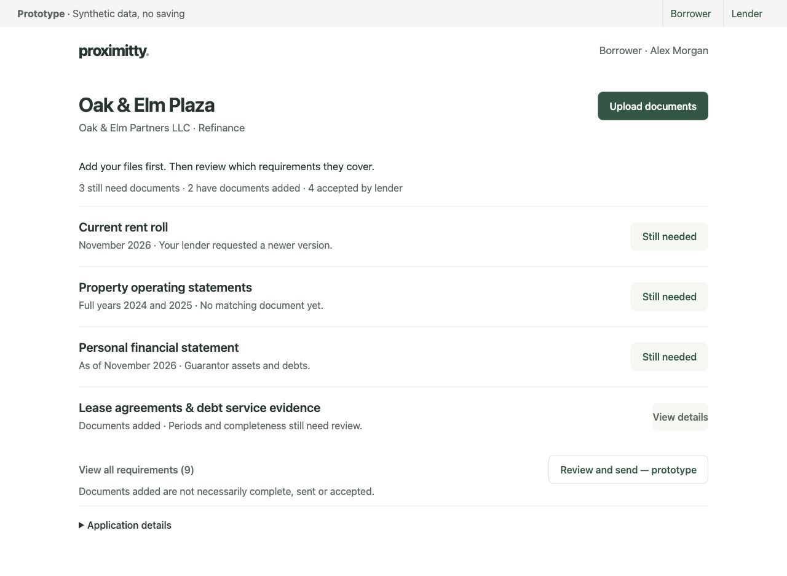
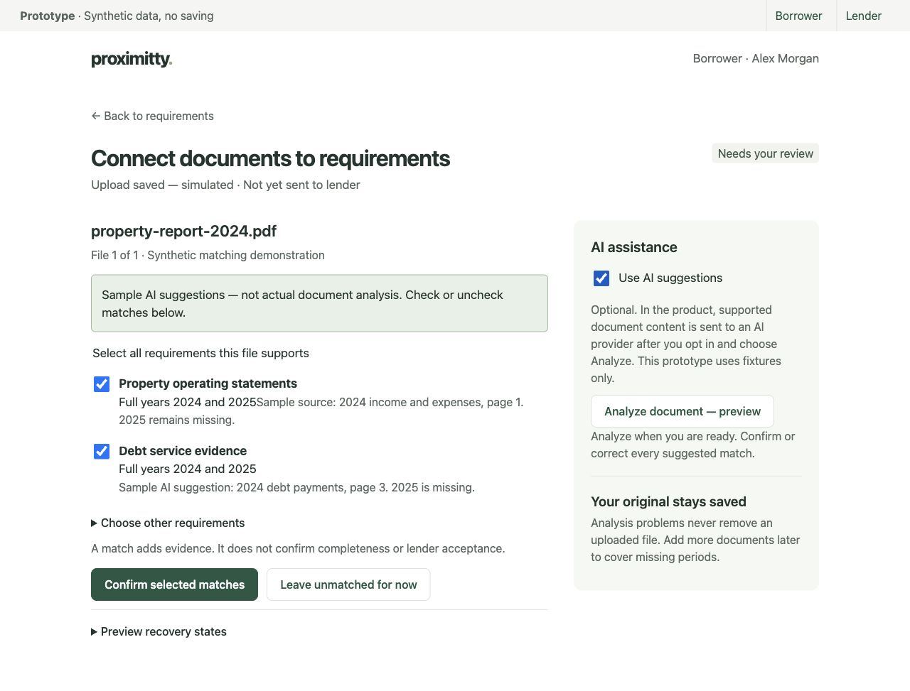
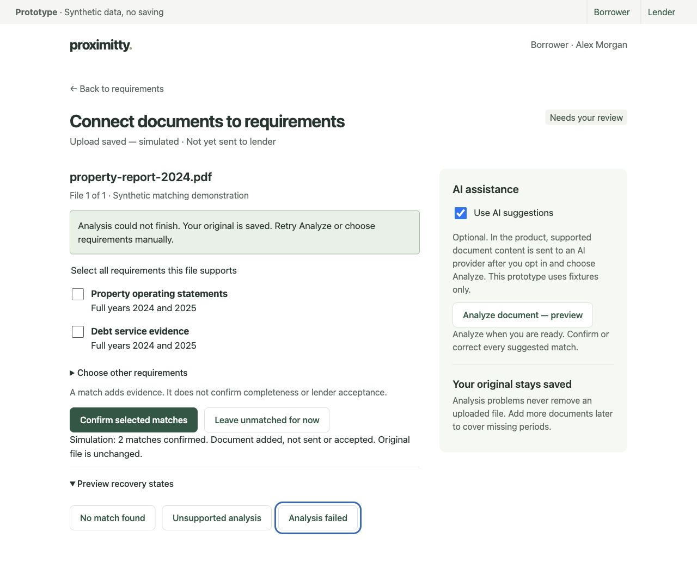
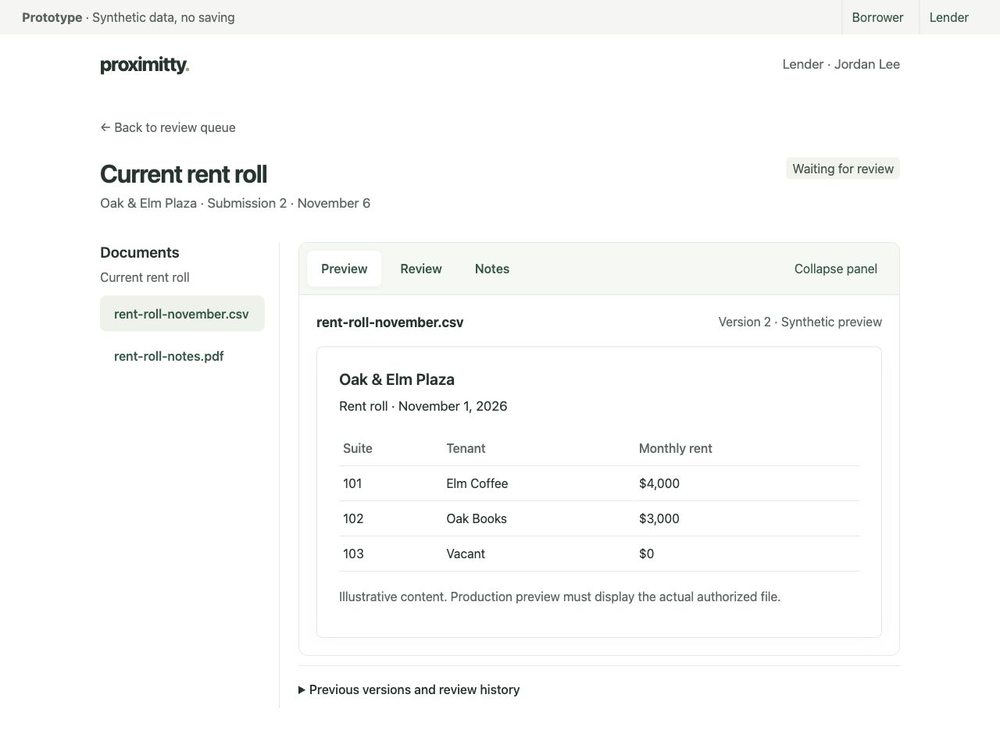
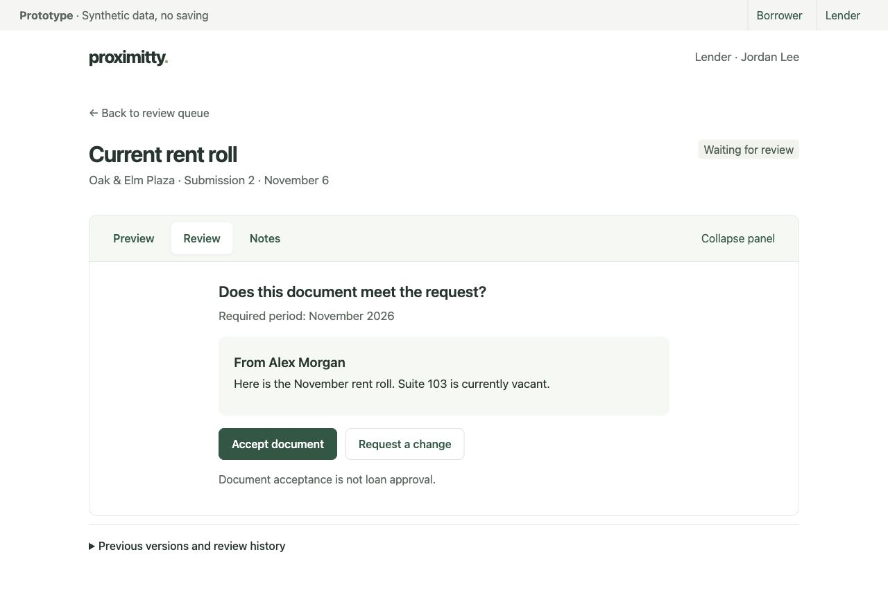
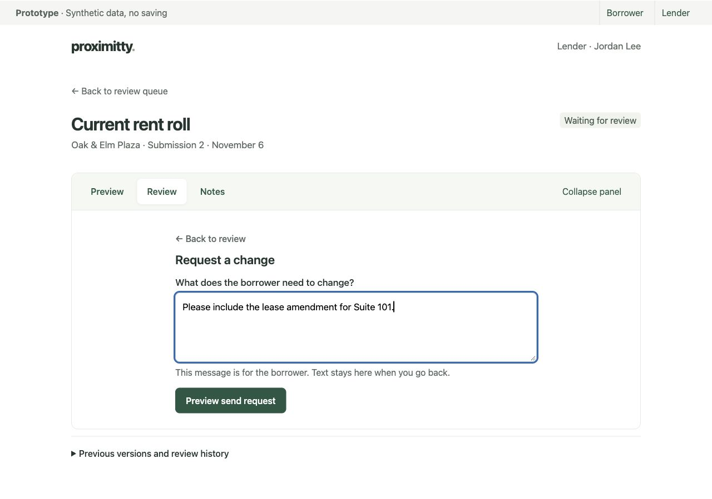

# Proximitty: upload first, then confirm coverage

November 6, 2026 · Current design direction. This supersedes the earlier recommendation to remove global upload. The user explicitly wants a prominent upload button, model-assisted requirement matching, and visible covered versus outstanding work. Frontend owns app implementation; this deliverable changes only the isolated prototype and this document.

## Review the artifact

Open [the self-contained clickable prototype](../artifacts/ux-redesign/index.html). No dependencies or external services are required. All documents, suggestions and results are synthetic. File selection records names in memory only; no bytes are read or stored, and no model calls occur. Reload resets interactions. Lender and submission screens are independent illustrative fixtures, not synchronized backend state.

Try: **Upload documents → Try sample documents → Preview saving files**. Leave AI off to match manually, or enable **Use AI suggestions → Analyze document — preview**, then check/correct the selected requirements and confirm. The two-file sample demonstrates one report supporting operating statements and debt evidence, and a second file adding another year of operating evidence. “Preview recovery states” demonstrates unmatched, unsupported and failed analysis. These evaluation controls do not belong in production UI.

## Primary borrower screen

Compact property identity and **Upload documents** appear first. The checklist shows required periods and plain coverage status immediately below. Request details remain accessible in any order. Application metadata and earlier history stay secondary. One full-checklist path keeps every requirement accessible.

Uploading no longer demands a category decision first. Request-specific uploading can remain a convenience inside a focused task; it must not be the only path. Multiple files may be selected, and each must receive its own progress/result. Matching follows durable file saving, not the reverse.

## Post-upload matching

The main area shows the saved original filename and editable requirement checkboxes. The side panel holds optional AI controls; it does not compete with confirming matches. This is a useful sidebar because assistance is secondary to the manual task. On a narrow screen, stack it without hiding manual matching.

Suggestions show a reason, required period, source reference where genuinely available, and missing coverage. The sample explicitly identifies 2024 evidence while 2025 remains missing. Suggestions may preselect checkboxes, but only **Confirm selected matches** changes confirmed mapping. “Choose other requirements” allows corrections. One file can be linked to several requests without copying its bytes; one requirement can collect multiple files and versions.

**A critical distinction:** a model identifying a document type has not established that every required period, party, schedule or page is present. Do not rename classification results “Requirements met.” Show evidence coverage and unresolved gaps; reserve **Accepted by lender** for an actual reviewer decision. Even several matching files may still be incomplete.

## State vocabulary

| Label | What it means / next action |
|---|---|
| Still needed | No suitable current evidence, or a specific remaining gap. Show period and missing item. Upload or explain. |
| Needs your review | Suggested matches await borrower confirmation/correction. They do not yet count as confirmed coverage. |
| Document added | At least one confirmed file link exists. State whether coverage is partial or still unverified. |
| Document added · Partial | Name the gap, e.g. “2024 added; 2025 still needed.” Keep it visible among outstanding work. |
| Waiting for lender review | Identified versions were included in a successful submission. Upload or matching alone must not produce this state. |
| Accepted by lender | Reviewer accepted the specified evidence version. This is not loan approval. |
| Unmatched document | Original upload exists without a confirmed request link. Keep it accessible for later matching; do not count it as satisfying a requirement. |

Avoid one combined progress percentage. Use short separate counts for still needed, partial evidence, documents added and lender accepted. Unsent files and unconfirmed suggestions also need visible actions. Production counts must derive from records; the prototype illustrates a limited fixture rather than a full state engine.

## Optional analysis and recovery

| Condition | Visible response | Available recovery |
|---|---|---|
| AI off | “AI is off. Choose requirements manually.” | Upload and multi-select matching remain fully available. |
| Saved, not analyzed | “Uploaded · Not yet sent.” | Analyze explicitly after opt-in, or match manually. |
| Analysis running | “Finding suggested matches…” separate from upload success. | Manual work remains available; handle interruption without indefinite loading. |
| No reliable match | “No reliable match found. Your original is saved.” | Select any applicable requests or leave unmatched for later. |
| Unsupported analysis | “This file is saved, but AI cannot analyze this format or scan.” | Manual matching; never demand re-upload solely because analysis is unavailable. |
| Analysis failed | “Analysis could not finish. Your original is saved.” | Retry analysis of the saved version or match manually; no duplicate upload. |
| AI switched off | Stop new analysis; explain existing suggestions are historical. | Manual matching continues; reject late-result mutations. |
| Save failed | Do not claim uploaded success or launch analysis. | Retain successful files and selected failed files when the browser allows; retry failed items only. |

Turning AI on does not itself start a call. Show verified processing scope/provider handling before real consent, and require explicit Analyze. No blanket OCR claim: accepted formats and supported analysis routes are distinct. A borrower correction must survive reruns; model output cannot silently overwrite confirmed mappings. Use original file/version identity to reject stale suggestions after replacement.

## Implementation-ready handoff

| Priority | Component / contract | Concrete change |
|---|---|---|
| P0 | `BorrowerOverview`, `CoverageList` | Prominent global **Upload documents**; no forced request selection. Compact identity and coverage list below. Preserve current period, lender feedback and partial gaps. One full-list path. Surface unmatched uploads, suggested matches needing confirmation and unsent updates. |
| P0 | `UploadDocuments` | Save private bytes and metadata before analysis; permit temporarily unmatched files. Batch picker with per-file filename/progress/success/error and retry. Existing files remain accessible through refresh. Success is not submission. |
| P0 | `DocumentMatching` | Show current original and editable multi-select request links. Support several files per request. Separate proposed matches from confirmed mappings and permit manual correction/unlinking without deleting evidence or changing old submissions. Current confirmed links must survive failed reanalysis. |
| P0 | `CoverageStatus` | Distinguish evidence-linked, coverage partial/unverified, sent and accepted. Derive counts and gaps from records; never mark complete solely from a classification score. Reviewer decisions remain version-specific. |
| P1 / M2 | `AnalysisControls`, suggestion provenance | Application-level opt-in, explicit Analyze, supported scope, persisted running/failure/result state, source references and uncertainty. Use the agreed server-side Mastra/OpenRouter path. No client credentials, new workers, broad OCR or upload dependency on AI. |
| P1 | Recovery, drafts and unmatched work | Persistent unmatched inbox/list entry; later manual remapping; preserve originals and text across refresh/failure. Retry saved-version analysis without re-upload. No forced wizard: users can return to overview or another document. |
| P1 | `RequestDetail`, lender review | Keep current file(s), purpose, period, explanations and explicit replace/add actions. Lender sees which files support each request, partial gaps and borrower corrections beside the evidence. Acceptance/change request, internal notes and history stay separate. |

M1 supplies upload-first manual matching and truthful coverage without AI credentials. M2 layers in real suggestions. The user’s desired final flow includes model assistance; a fixture demonstration is not delivery of M2. Confirmed mapping is also not a substitute for the existing submission/receipt and review implementation requirements. Coordinate any persistence contract changes with the database owner; frontend should not independently change schema/runtime ownership.

## Five acceptance checks

1. An unfamiliar borrower finds **Upload documents** immediately and saves a file without choosing a requirement or enabling AI first.
2. After optional analysis, the borrower can explain which matches are suggestions, correct one, select several requirements, and confirm. No match is treated as lender acceptance.
3. A second file can support the same requirement. Missing periods remain visibly outstanding; matching a 2024 statement alone cannot complete a two-year request.
4. With AI off, unsupported, failed or unmatched, the original stays accessible and manual matching works. Reload restores actual saved files and confirmed mappings in the implemented product.
5. Keyboard focus reaches every upload/matching/confirmation/recovery control, task text is at least 16px, primary controls at least 44px, and 200% zoom/narrow screens preserve the core flow. Failure messages state what was preserved and offer the next action.

Internal checks: opened the upload-first overview, selected the two-file sample and entered matching; confirmed AI defaults off; enabled fixture analysis and observed editable source-linked suggestions; confirmed two matches using Enter; exercised the analysis-failed state while the original remained visible. Screenshots above record the current proposal. No real upload, AI, restart persistence or external participant study was performed. Full keyboard, 200% zoom and narrow-screen checks remain required before release.

Prior request-first screenshots in the artifact folder remain supporting references; the upload-first overview and post-upload matching images above govern the revised borrower direction. Lender review and login guidance remain applicable.

## Login cleanup — frontend handoff

Source review: `app/login/page.tsx`, root layout and applicable global styles. This is a source-based recommendation, not a fresh rendered login inspection. Keep the existing Better Auth flow, session lookup and role-based destination. Frontend owns implementation; no app/runtime edits were made for this review.

**The concrete visual problem:** the form inherits 14px body/button text and a global button reset with no background or border. Its submit button only overrides height, so the primary action has no clear visual surface. Inputs use isolated inline styling, heading/paragraph margins are reset globally, and the page has no deliberate spacing between heading, introduction and form. This creates an unfinished entry screen even though labels and autocomplete already exist.

### Recommended screen

A quiet white or near-white page, small Proximitty wordmark, and one left-aligned form column, approximately 400px wide with 24px mobile gutters. Place it comfortably toward the upper middle; allow normal vertical scrolling on short screens. No sidebar is useful before sign-in.

Order and exact copy:

1. Small wordmark: **proximitty.**
2. Heading: **Sign in**
3. One sentence: **Continue to your document workspace.**
4. Persistent label **Email address**, then email input.
5. Persistent label **Password**, then password input with a visible **Show password** button.
6. Full-width green **Sign in** button, changing to **Signing in…** while pending.
7. Error text only when needed, beside the form action. A quiet **Local demo · Synthetic data only** note may sit below the form when applicable.

Use 28–32px heading and at least 16px labels, entered text, button and error copy. Inputs and main button should be at least 48px high, with subtle borders and 8px corner radius. Use about 24px from intro to form and 16–20px between fields. One restrained primary color is enough; avoid a large card shadow, illustration, dashboard framing or decorative panels. Use scoped login classes so portal globals do not dictate form spacing.

### Remove or avoid

- Replace “Sign in to Proximitty” plus “Use your borrower or lender account” with the simpler hierarchy above. The brand and authenticated role routing already establish those facts.
- Remove database/startup instructions from user-facing failure copy. The current “Check that the local database is running” belongs in operator documentation, not the login form.
- Do not add borrower/lender selection, fake social sign-in, unimplemented password-reset/sign-up links, or public demo credentials just to fill space.
- Do not remove authentication or add a bypass. The user’s demo tradeoff discussion does not authorize that change.

### Keyboard and failure details

Keep native form submission, nested labels or explicit label/input associations, `type=email`, `autocomplete=username` and `autocomplete=current-password`. Add stable input IDs for error association. The password visibility button must be `type=button`, have an updated accessible name (“Show password” / “Hide password”), and leave the value intact. Tab order should follow email → password → visibility → sign in; Enter submits, and focus must remain visible.

Retain entered email/password on a failed attempt within the active form; never put passwords in local storage. Use the existing alert only when an error exists and associate relevant errors with inputs. Wrong credentials: **“We couldn’t sign you in. Check your email address and password, then try again.”** Service failure: **“Sign-in is temporarily unavailable. Please try again.”** Re-enable submission after failure. While pending, prevent duplicate requests, keep the action width stable, announce “Signing in…,” and avoid replacing the form with a spinner. Preserve current values and predictable focus; do not focus a disappearing control. Missing-field validation should identify the field, not just color its border.

If sign-in succeeds but workspace/session loading fails, use **“We couldn’t open your workspace. Try again.”** Distinguish this from incorrect credentials in implementation; do not expose database details. Keep recovery within the existing auth architecture. Do not invent a new account-support path.

**Priority:** first fix the visible primary button and 16px form typography; then scope spacing/layout and simplify copy; then verify password visibility, failure recovery, keyboard order, 200% zoom and short/mobile viewport scrolling. Success means an unfamiliar person can identify the required fields, sign in, or recover from a failed attempt without explanation. No participant validation has been performed.

**Runtime boundary:** canonical browser/auth origin is `http://127.0.0.1:3001`; Next.js runs on the host. Docker Compose runs PostgreSQL 17 only, on loopback host port 5433 with persistent `postgres_data`. Private uploads remain in the configured persistent local data directory. This login proposal needs no changes to those settings, services, dependencies or data. Platform owns runtime/env/startup and preview restarts; database owner owns migrations/repositories. AI credentials remain optional for M1 and server-only. No runtime conflict identified from this presentation review.

## Lender workspace: Preview / Review / Notes (latest user request)

The user now requests a collapsible document workspace with three choices. “Previous” is interpreted as **Preview** in this context; previous versions remain a separate history disclosure. The prototype's `#review` screen implements this interaction and supersedes the earlier permanent decision sidebar.

- **Preview:** show the selected original/version with filename, document selector if multiple files, and real authorized content. Preserve a Download original action. PDF/image preview can use supported safe rendering; CSV/XLSX need bounded, non-executing previews. Never execute formulas/macros or inject uploaded HTML. Unsupported formats, encrypted files and rendering failures must show a clear fallback, not a fake extracted view. Match download/preview authorization to the application and file version.
- **Review:** one concise question, required period, material borrower explanation, and **Accept document** / **Request a change**. Acceptance refers to the selected evidence version(s), not the loan. Do not hide unresolved findings needed to decide.
- **Request a change:** replace the decision view within Review with one labeled borrower-facing text field and Send action. **Back to review** restores the two decisions without discarding the draft. Move focus into the response field on entry and back to a decision control on return.
- **Notes:** private lender notes with clear audience and saved/unsaved state; never reuse the borrower-message field. Preserve text across tab switches, collapse, Back and recoverable failures. Production draft persistence must remain scoped to account/application/request.
- **Collapse panel:** hide panel content while keeping selected version and Preview/Review/Notes controls visible. Switching tabs expands the panel. Retain selected view and drafts. Native buttons, tab/tabpanel ARIA associations, arrow/Home/End navigation and visible focus are required. Stack gracefully on small screens; avoid nested scrolling traps.

Frontend is explicitly authorized to implement this now. Real preview, server-backed decisions, private notes and persistence remain frontend/backend integration work; the artifact has synthetic evidence only. User also requested publishing: target the existing local demo at `http://127.0.0.1:3001`. Public hosting is outside the established deployment scope. Platform owner handles any necessary preview refresh/restart; no independent ports, auth origins or service changes.

Prototype check: switched Preview → Review, opened the change form, entered sample text and returned with Back; focus returned to the decision. These screenshots are design artifacts, not evidence of deployed application implementation.

Implementation alignment: frontend reports the current review API saves a decision for the request's current file set, not one independently selected preview file. The production Review panel must explicitly state that scope; selecting a different preview must not silently change the decision target. Initial preview support is PDF, images, CSV and plain text through the existing authorized endpoint; spreadsheet preview is deferred with Download original fallback. Private-note draft was also checked across collapse/reopen in the synthetic prototype.

### Persistent document list — latest correction

Keep individual document filenames visible in a left sidebar while Preview, Review or Notes is active. A request-only list or dropdown does not satisfy this requirement. Selecting a file updates the filename and authorized content, switches to Preview and expands the panel. The left list remains visible when panel content is collapsed. Group by request when necessary; make the selection clear with text and styling, and allow wrapped long filenames. Preserve request-specific review drafts and scoped private notes when switching. The current review API applies to the full request file set: selecting a preview must not silently narrow acceptance. On narrow screens stack the list above the panel. The prototype now shows two selectable synthetic files; frontend has received the explicit implementation correction before final publication.

### Borrower list visibility — explicit user correction

Render every request in the current borrower list by default. If six requests need attention, show all six in order and let the user scroll the page. Remove three-item caps, “show remaining” gates and extra-click hiding of outstanding work. Do not introduce a nested scroll area or pagination for this small list. This supersedes earlier suggestions to show only a short default list. Preserve concise rows, visible periods/status and simple Upload labels.

## Borrower requirement files — current implementation request

Each requirement row now needs two visible actions: **Upload** (quick multi-file picker) and **View details**. Keep document name, period, state and file count beside them; do not hide additional requirements. Quick upload automatically links files to that requirement and does not force opening detail first.

Requirement detail shows purpose, period, lender feedback, and all current linked files with original filename/date and **Preview**, **Download**, **Remove**. **Add documents** offers the same multi-file upload flow. Use the shared authorized document preview component used by lenders, including format/size fallback; no AI processing is needed. Preview selection must not change file mappings or a review decision.

Upload several files independently, with per-file progress, confirmed success and actionable failures. Keep successful files if another fails. Retry failed items only; do not make users select/upload successful files again. Report “3 files added; 1 needs retry” rather than claiming the whole batch failed or succeeded. Do not call a request complete just because it has several files.

**Remove from this requirement** is the intended safe semantics: explain “This file will no longer be linked to this requirement. Files used elsewhere and earlier submissions are kept.” Use confirmation for removing an existing link, identify the original filename and requirement, and update only on server confirmation. Failure keeps the row with Retry. Never globally delete a shared original, change an old submitted package, or leave prior acceptance appearing current after its evidence changes. If the original becomes unmatched, keep it available for later mapping under uploaded documents. A current request with no files returns to the appropriate needed/follow-up state. Backend owns the precise authorized endpoint and history behavior.

Implement with existing component/API foundations: frontend handles batch orchestration if uploads remain one request per file, requirement detail and preview; backend supplies scoped authorized unlink and correct current snapshot/history. Verify two-file upload to one request, mixed success, preview/download access, removal of one file, all-files-removed state, shared-file link preservation, review invalidation and submitted-history preservation. Test roles and unrelated application access. No data reset or runtime redesign is authorized.

### Requirement dialog scrolling and preview — current correction

When requirement details or upload dialog is open, lock background page scrolling and restore its exact position on close. Dialog content scrolls independently; reaching its top/bottom must not pass wheel/touch scrolling through to the unfocused page. Keep keyboard focus within the modal and return it to the opener on close.

Document Preview should replace the file-list view inside the same dialog with a focused preview subview: request identity, selected filename, Back to documents and Download original remain clear. Do not append preview beneath a long file list or jump the user to its bottom. Back restores file-list position and focus to the selected file's Preview control; queues and drafts survive the view change. Preview errors stay within this subview with retry/download fallback. Verify small screens, keyboard, wheel/touch boundary scrolling, modal dismissal and background restoration.

## Background analysis ownership update

The user has now explicitly approved a queue service/workers and prioritization between upload-triggered background analysis and active **Verify completeness** calls. This supersedes earlier no-worker and exclusively on-demand analysis guidance in this document. Do not implement competing orchestration in the frontend or UX prototype. The dedicated backend owner defines serving/job orchestration and Mastra/OpenRouter plumbing in `docs/BACKEND_PLAN.md`; AI owns prompts/extraction/matching/evidence/evaluations, database owns schema/repositories, platform owns Docker/runtime, and frontend owns presentation. Detailed event, status, cancellation and priority contracts remain pending alignment.

Interaction guidance to carry into that contract:

- Upload success remains independent of analysis completion. Show saved files immediately; queued or failed analysis must never erase an upload or block manual matching.
- With AI enabled and the agreed consent scope, an upload may trigger background analysis. Show plain states such as **Waiting for analysis**, **Analyzing**, **Suggestions ready**, and **Analysis needs retry**. Do not imply completion merely because work was queued. Avoid invented progress percentages or response-time promises.
- **Verify completeness** is an explicit borrower action with a visible pending/result state and clear scope: which requirement/file versions are being checked. Its priority relative to upload-triggered work is a backend scheduling decision; UI should not promise immediate processing or implement its own queue.
- Classification suggestions and completeness findings remain separate from lender acceptance. Confirmed matches can coexist with missing periods/pages, uncertain coverage or an explanation for the lender.
- AI-off users retain upload, manual matching, explanations and submission. Stopping new work and handling already-running/queued jobs must follow the backend consent/cancellation contract; do not claim that provider processing has been retracted.
- Refresh/reopen should recover persisted job state. Results must identify their source versions; replacement, unlinking or consent changes must not let stale jobs silently overwrite current mappings or revive old acceptance. Avoid duplicate jobs/results on retry under the agreed idempotency contract.

Acceptance after contracts align: a saved upload remains usable while analysis waits; an explicit verification request is acknowledged and its eventual result is traceable; failed/interrupted work has an actionable recovery path; refresh preserves status; late results cannot mutate superseded evidence; manual workflow remains usable with AI off. Queue order, concurrency, cancellation and estimated waits are not claimed implemented or verified by this UX update. No runtime or app implementation changes are made in this pass.

### Backdrop dismissal

Clicking outside the borrower requirement-details dialog, including its preview subview, closes the dialog through the existing close path. Inside clicks must not close it; a drag that starts inside and ends outside must not count as backdrop dismissal. Preserve current busy-operation guards, queued selections/drafts, background scroll restoration and opener focus. Escape and the visible close button remain available. Verify with actual backdrop clicks, inside clicks, cross-boundary drags and preview open.

## Lender requirement-first layout — latest simplification

Start with one prominent **Requirement** selector (named requests such as Current rent roll or Debt service evidence). Treat the user's “requirement category” as this document-request selection; avoid adding another category/filter level unless a real grouping need is established. Then show a two-column workspace: only the selected requirement's documents on the left, Preview / Review / Notes on the right. The left list must not include unrelated request groups. Selecting a requirement resets preview to a valid file for that requirement; selecting a file activates and expands Preview without losing scoped drafts.

Remove the stacked request selector + repeated title + purpose + period + selected-file heading/date block above the panel. Keep property/back navigation compact, selector before the columns, and filename/download/tab controls in a restrained panel header. Put criteria/purpose/period and the precise decision scope in Review where they support the decision; keep material feedback and unresolved findings visible there. Application metadata and prior history remain on demand. An empty requirement still opens the workspace with clear no-files text and a Review action to request evidence. Mobile stacks the scoped document list above the panel.

Keep readable labels, obvious selection, keyboard tabs and the existing separate change-request screen with Back. Do not reduce review correctness, note privacy, authorized file access or draft retention to achieve a visually shorter screen. Frontend owns this change and platform publishes only after focused verification.

### Explicit review scope — approved refinement

The selected file controls **Preview** only. **Review requirement** applies to the selected requirement's entire current evidence set. In the review panel show the requirement name, a concise statement that the decision applies to the requirement and its N attached documents, and a compact list of those filenames. Label acceptance **Accept requirement** and the follow-up action **Request changes**. Do not repeat the file list above every tab or add a second approval workflow for files.

Within the separate Request changes subview, an optional **Which document needs attention?** choice can reference an attached file or **Missing document / entire requirement**. This adds context to requirement-level feedback, not a file-level acceptance status. Persist the reference truthfully through the existing feedback contract (readable text if structured references are unavailable). Back retains the draft. Switching preview files never changes the decision target, while switching requirements retains their separately scoped drafts and valid evidence checks.

Label notes as internal and explicitly application-wide, matching current storage. Do not imply that changing the preview file or requirement creates a separately scoped note. Keep all scope explanations inside the relevant panel so the overall workspace remains light.

### Preview-first workspace and floating review — latest approved direction

This supersedes the three-tab right panel. Keep the selected requirement's documents on the left and only the document preview on the right, with a restrained filename/download header. The user preferred the Requirement strip design exploration; align a wrapping requirement strip above the workspace without hiding requirements.

One floating **Review requirement** button opens a focused review dialog over the preview. Reserve clearance so it does not cover document controls or content, including on mobile. The dialog identifies the requirement and all current attached files, then presents **Accept requirement** and **Request changes**. Acceptance still applies to the full requirement evidence set. Request changes replaces the decision screen inside the dialog; Back retains the message and optional file reference. Preserve revision validation and all existing review semantics.

Remove the Preview / Review / Notes tab bar. Retain private application notes through a quiet **Notes** action in page chrome opening a separate dialog. Review and notes dialogs lock background scrolling, contain focus, restore focus/position on close, and support Escape, close button and safe backdrop dismissal with busy guards. Closing review restores the same preview selection without a page jump. Empty requirements remain reviewable for requesting missing evidence, with acceptance disabled. Verify desktop/mobile spacing and modal behavior before local publication.

### Compact lender AI mode

Replace the large lender AI assistance box with an accessible **AI mode** switch in the top page controls beside Notes. This is a remembered lender display preference: enabling it reveals compact AI tools within review, without starting analysis. Keep the main workspace focused on files and preview, and preserve explicit actions for actual AI checks.

Latest explicit user correction: borrower AI settings must not gate lender AI mode or lender-initiated **Use AI to verify completeness**. Lender verification has its own role-authorized execution context; it must not enable borrower background analysis or modify borrower preferences. Keep the lender verification action available regardless of borrower settings, with honest pending/error handling. Backend must preserve this separation through queueing, dispatch, cancellation, retries and result freshness, not just remove the disabled UI state. Borrower preferences continue controlling borrower AI and upload-triggered analysis.

### Personal AI preferences and removal of lender notes — latest correction

Remove Notes from lender workspace navigation and dialogs; retain historical stored notes without exposing the obsolete control. AI settings belong to each authenticated individual user and follow that user across applications. Neither an application-level setting nor another borrower/lender's setting may control the current user's AI mode or verification. Persist the personal preference server-side, isolate users on shared browsers, and make the scope clear in concise help text. Toggling mode does not itself dispatch analysis. Explicit lender completeness verification stays available independently of borrower settings; automatic upload analysis follows its initiating user's setting. This supersedes the application-scoped preference and notes-access instructions above.

### Remove global AI controls — latest UI simplification

Remove the global **AI assistance** box from the borrower page. Remove the **AI mode** switch and **Info** control from lender page chrome. Keep explicit **Use AI to verify completeness** within lender review available independently of personal or borrower mode. These removals change presentation only; retain personal preference storage, existing job authorization and requirement-specific functionality. Remove copy directing users to the deleted global assistance panel.

### Borrower application selection and lender header cleanup

After login, borrowers see a simple list of their active, authorized applications and explicitly select one to enter its workspace. Show all entries with concise property/application identity and status; support empty and single-application lists without silently choosing an application. Provide a return path to the list. Switching must clear application-specific state and revalidate access; use the domain's active definition, preserving access to submitted applications where appropriate.

On lender pages, remove the redundant **Local demo · Synthetic application / Switch account** bar. Keep Sign out aligned with the lender identity inside the primary header, with responsive wrapping.

### Explicit Send for review boundary — latest user requirement

Place a floating **Send for review** action at the bottom of the selected borrower application's workspace, with reserved content clearance and mobile safe-area spacing. Uploading alone does not send documents. Reuse the existing submission workflow and show accurate pending, failed, sent and unsent-change states. Do not place this action on the application list.

Lenders can see only explicitly submitted evidence, not the borrower's live draft uploads or subsequent unsent mapping/removal changes. Keep the last submitted package visible until the borrower sends again; never silently publish existing drafts. Enforce the boundary in server snapshots, direct document preview/download endpoints, AI evidence access and review decisions. A never-submitted application shows a waiting-for-borrower state with no document leakage. Borrowers retain draft access and prior submitted history. Sending must bind a consistent revision snapshot and handle concurrent uploads or edits without misrepresenting which files were sent.

### No-login local demo and role switch

In explicitly enabled local demo mode, open the borrower application list without a login form or credentials. Replace Sign out with one compact **Switch to lender** / **Switch to borrower** button in the existing header. Preserve selected application when accessible to the destination role. Avoid reintroducing a demo banner. The switch changes the server's synthetic role context so submitted-only lender visibility remains real. Use only configured demo identities; keep ordinary authentication outside demo mode. This is a demo interaction simplification, not a removal of document access boundaries.

### Bulk-first borrower workspace — latest direction

On entering a selected application, default to **Bulk upload**: a large multi-file drag-and-drop area on the left and compact requirement status tiles on the right. Encourage uploading the whole document set together. Provide two peer views, **By requirement** for existing targeted upload/details/preview flows and **Organize files** for manually adding/removing many-to-many links between saved files and requirements. Preserve queues, drafts and selected files when changing views; on mobile stack the status tiles beneath the drop zone.

Requirement tiles reflect actual current AI completeness, not file count or lender acceptance. Use text and icons with color: checking/queued, complete, partially covered, missing information, unsupported/unknown, and recoverable error. Never promise results after a fixed number of seconds. Personal AI-enabled uploads may use the existing analysis pipeline; show a compact contextual personal preference control if needed, without restoring the large AI assistance box. Unsupported formats and AI-off users retain manual organization and targeted uploads. Any green check must be tied to a current assessment of the requirement evidence; stale results cannot appear fulfilled.

Keep the floating **Send for review** action and private-draft boundary across all three views. Manual organization supports zero or multiple requirement links per document, persists through authorized APIs, and preserves revision checking and user unlink decisions. Bulk upload handles per-file success/failure and retries without duplicating successful files. Requirement detail remains available for understanding gaps and previewing documents.
